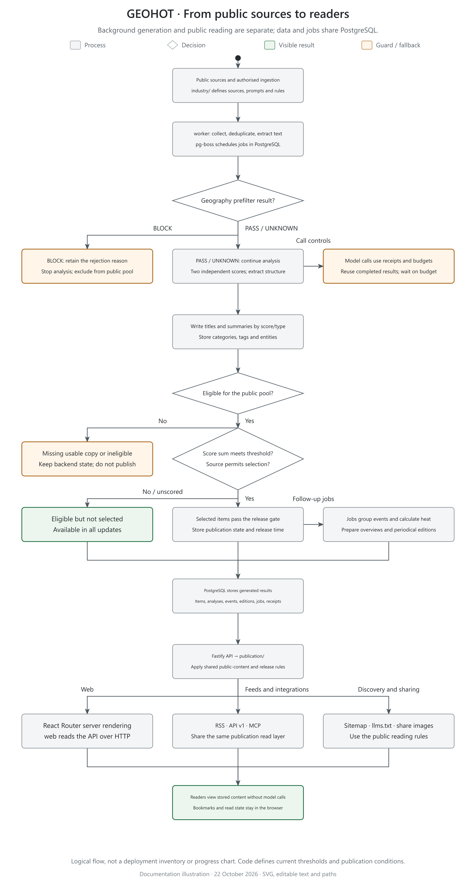

<sub>🌐 <a href="README.md">中文</a> · <b>English</b> · <a href="docs/manual.md">Operations and development handbook</a></sub>

<div align="center">


# GEOHOT · Geography in focus

**A daily reading of a changing world.**

An earthquake, a changing city, a new satellite image: geography takes shape in the news every day. GEOHOT follows public sources, selects material for its spatial significance, brings related reporting into a shared event, and turns it into geography editions you can revisit.

**Read the essentials, follow the evidence, return to the source.**

[](https://xxc2007.me/geohot/)
[](#architecture)
[](LICENSE)

Read without an account, search and filter by category, save local bookmarks or subscribe through RSS. Public APIs and MCP give developers access to the same published content. The website’s reading interface and editorial output are in Chinese.

[Film](#-product-film) · [Reading experience](#reading-experience) · [Selection](#how-material-becomes-a-selected-story) · [Architecture](#architecture) · [Open interfaces](#pages-and-open-interfaces) · [Run locally](#local-development-and-adaptation) · [Content boundaries](#content-boundaries) · [License](#-license) · [Star History](#star-history)

</div>

<p align="center">
  <a href="https://xxc2007.me/geohot/"></a>
</p>
<p align="center"><sub>Selected feed · categories, events and stories · captured from the live site on 16 October 2026</sub></p>

## 🎬 Product film

A 42-second journey through GEOHOT: browse selected stories, explore categories, follow an event summary and reporting timeline, then open the geography editions and topic pages. Real website captures are paired with a soft piano score and gentle transitions. On-screen titles are in Chinese.

Play it directly below.

https://github.com/user-attachments/assets/d85128b8-810d-48b8-a6eb-3e032e81011a

[▶ Watch in the 1080p player](https://xxc2007.me/assets/promo/geohot/?v=20261016) · [Open MP4](https://raw.githubusercontent.com/xxc2007/GeoHot/main/docs/promo/geohot-promo.mp4?v=20261016)

<sub>1920 × 1080, made with Video Shotcraft. Screenshots and footage preserve the news available at capture time; visit the site for current coverage.</sub>

## Reading experience

### Follow the story beyond a single report

Each card presents a Chinese headline, summary, recommendation, source and score, helping readers decide what to explore. Related reporting is grouped into an event page, where a summary and timeline connect the developments. Original links remain available for further reading and verification.

### Find a direction, then build a broader view

The selected feed offers a quick entry point; All updates supports wider searching and filtering. The hot-events page lists events that meet its participation criteria, while topics support ongoing reading. A geography daily is scheduled for 08:00 Asia/Shanghai, alongside weekly and monthly editions and archives.

| Category | Coverage |
|---|---|
| Physical geography | Landforms, climate, hydrology, soils, vegetation and hazards |
| Human geography | Population, cities, industry, transport and urban–rural development |
| Regional geography | Integrated change across basins, polar regions, plateaus, deltas and city clusters |
| Political geography | Boundaries, territory, strategic passages and maritime rights |
| Historical geography | Rivers and coasts, administrative boundaries, historic settlements and maps |
| Frontier geography | New research evidence, methods, findings and academic developments |
| Geographic information systems | Remote sensing, positioning, spatial data, GIS software and open-source ecosystems |

Definitions live in [`industry/taxonomy.ts`](industry/taxonomy.ts). Bookmarks stay in the current browser; RSS, public APIs and MCP support personal subscriptions and automated reading workflows.

## How material becomes a selected story

**Collect and deduplicate → pre-filter → score twice → apply source-tier thresholds → group events → calculate heat → publish editions**

| Stage | Approach |
|---|---|
| Sources and pre-filtering | Collect from registered public sources, deduplicate by normalized URL, then assess geography relevance and information content. See [`industry/sources.json`](industry/sources.json) and the [pre-filter standard](industry/prompts/prefilter.md). |
| Scoring and selection | Two scoring passes use the same standard. Their sum is checked against the source tier’s admission threshold; cards display the average score. Values and calculation notes live in [`industry/selection.ts`](industry/selection.ts). |
| Events and heat | Group reporting about the same event. Heat reflects independent-source coverage and time decay; the page remains empty when participation criteria are unmet. |
| Writing and publication | Produce Chinese headlines, summaries, recommendations, event overviews and periodical editions. Public content is read through [`publication/`](packages/backend/src/publication/). |

**People define the standard; models analyse individual items.** Taxonomy, sources, prompts and selection rules live in [`industry/`](industry/). The admin interface supports review and correction, and readers can report errors. Scores support selection and do not express a probability of factual accuracy. Current thresholds are empirical and have not been calibrated against a human-labelled evaluation set.

## Architecture

GEOHOT is built on the open-source [AIHOT](https://github.com/KKKKhazix/AIHOT) framework, adapted through a geography-specific configuration layer. Applications and shared processing live in `apps/` and `packages/`; taxonomy, sources, prompts, branding and page configuration are concentrated in `industry/`.

| Layer | Choice and responsibility |
|---|---|
| Runtime and organisation | Node.js 24 executes backend TypeScript directly; npm workspaces manages apps, shared packages and field configuration. Requirements: [`package.json`](package.json). |
| Pages | React Router server rendering, React and Tailwind CSS for feeds, events, editions and topics. |
| API | Fastify serves public read endpoints and authenticated management endpoints. The frontend reaches the backend over HTTP. |
| Data and jobs | PostgreSQL stores items, events, editions and sessions; pg-boss uses the same database for queues and schedules. |
| Model processing | The worker runs analysis and writing through [receipts and budget controls](packages/backend/src/providers/receipts.ts). Public pages read generated content; reading does not trigger model calls. |
| Consistency | Web pages, RSS, APIs and MCP share a publication read layer to keep their content aligned. |

### How it works

The upper half follows an item through collection, prefiltering, scoring and publication decisions. The lower half shows how stored results reach each public interface through a shared read layer. Amber marks blocking, waiting or control conditions; green marks public results. Source counts, model names and numeric thresholds remain in configuration rather than being frozen into the diagram.

[](https://raw.githubusercontent.com/xxc2007/GeoHot/main/docs/architecture/flow.en.630ca94064fa.png)

Click the image to open the 3600 px PNG directly, then click again to view it at its original size. [Editable SVG source](docs/architecture/flow.en.svg). Source references: [apps/worker/src/main.ts](apps/worker/src/main.ts) · [packages/backend/src/editorial/analyze.ts](packages/backend/src/editorial/analyze.ts) · [packages/backend/src/providers/receipts.ts](packages/backend/src/providers/receipts.ts) · [packages/backend/src/publication/rules.ts](packages/backend/src/publication/rules.ts) · [packages/backend/src/publication/](packages/backend/src/publication/) · [industry/selection.ts](industry/selection.ts) · [apps/web/server.ts](apps/web/server.ts).

To update both diagrams, install the documentation tool with `npm ci --prefix docs/architecture`, edit the bilingual labels in [`render.mjs`](docs/architecture/render.mjs), and run `node docs/architecture/render.mjs` to regenerate the SVG sources and high-resolution PNGs. See the [export notes](docs/architecture/README.md).

## Pages and open interfaces

Paths below are relative to the live site’s `/geohot/` prefix.

| Entry | Purpose |
|---|---|
| `/` · `/all` | Selected feed and all updates, with search and category filters |
| `/story/:publicId` · `/items/:id` | Event overviews, reporting timelines and individual items |
| `/hot` · `/topics` | Hot events and topic tracking |
| `/daily` · `/weekly` · `/monthly` | Periodical editions and their archives |
| `/starred` | Bookmarks stored in the current browser |
| `/agent` · `/feedback` | Integration guidance and reader feedback |

- **RSS:** selected summaries at [`/feed.xml`](https://xxc2007.me/geohot/feed.xml), all updates at `/feed/all.xml`, daily editions at `/feed/daily.xml`, plus weekly, monthly and category feeds.
- **Public API:** read endpoints under `/api/v1/`, documented in [`openapi-v1.json`](https://xxc2007.me/geohot/openapi-v1.json).
- **Agent integration:** MCP at `/api/mcp`, alongside `/llms.txt`; see the [integration page](https://xxc2007.me/geohot/agent).
- **Current figures:** consult [site statistics](https://xxc2007.me/geohot/api/site/stats) and the public website for source and content totals.

## Local development and adaptation

Node.js 24.11 or later is required. Install dependencies, then initialise local configuration:

```bash
npm ci
npm run env:init
```

The initialiser creates local environment files and random secrets, and refuses to overwrite existing configuration. Database, API, worker and web startup order, ports and verification commands are documented in the [operations and development handbook](docs/manual.md). The repository provides a local model stub and fixed fixtures for development and CI verification.

Keep collection, model calls and other external-access switches off by default. Run the real pipeline with a separate configuration layer as described in the handbook, preserving the separation from development and tests.

To adapt the project to another field, start with `industry/`: site identity, taxonomy, sources, prompts and branding. See the [customisation guide](docs/customize.md) for the process, and use the code for current configuration values. Operational guidance is in the [runbook](docs/geohot-runbook.md).

## Content boundaries

Summaries, scores and event overviews support reading; verify important information against the original sources. Hazard and warning coverage is not an official alert or a basis for emergency decisions. Sources show summaries and original links by default; full-text display depends on the publisher’s permission.

## 📄 License

[MIT](LICENSE) © 2026 数字生命卡兹克 (upstream framework). Geography configuration and brand maintained by Xiong Xinchen (熊鑫晨).

Upstream copyright and the derivative notice are preserved in [NOTICE](NOTICE). GEOHOT uses its own name and mark; upstream names and logos are not included in the code licence. Third-party assets and source content retain their respective terms. Full policies are available on the site’s terms and privacy pages.

## Star History

<p align="center">
  
</p>

---

<div align="center">
  <sub>Follow the news. See the geography.<br>Editorial standards and code · Xiong Xinchen · <a href="https://xxc2007.me/geohot/">Read online</a></sub>
</div>
