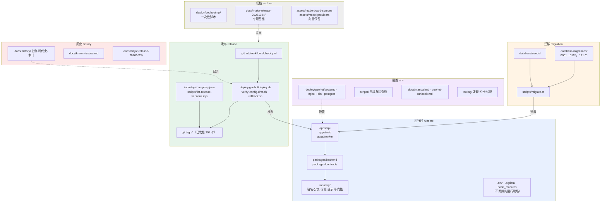

# 仓库目录地图（PROJECT-MAP）

一句话：这个仓库不是「一个网站」，而是**一个行业包 + 三个进程 + 一套发布与运维包 + 一座档案库**。
同一份代码在不同目录里承担完全不同的生命周期，混放会直接导致「本地能跑、线上不对」或「删掉以为是缓存的东西，其实是唯一副本」。

- 基准：`main` @ `2e5edf22ceb76548646fe92d20b0dc8fa7ec59b3`（2026-11-21），`git ls-files` 共 **1290** 个跟踪文件。
- 各目录文件数取自 `git ls-files <dir> | wc -l`（见文末复现）。
- 架构与运行原理见 [`architecture.md`](architecture.md)；目录的历史成因见 [`history/README.md`](history/README.md)。

---

## 一、根目录树

```
GEOHOT/
├── apps/                 运行时 · 三个可执行进程（22 + 186 + 4 个文件）
│   ├── api/              Fastify：站内接口 / 公开 API v1 / RSS / MCP / 后台 / 图片代理 / 分享图
│   ├── web/              React Router SSR 页面；只通过 HTTP 读 api，不碰数据库
│   └── worker/           pg-boss 队列与定时任务入口（main.ts / schedules.ts）
├── packages/
│   ├── backend/          运行时 · 全部业务逻辑（195 个文件），见下节
│   └── contracts/        运行时 · 前后端共用类型与常量（15 个文件）
├── industry/             运行时 · 行业包：站名文案、分类、主题、信源、提示词、门槛、品牌（53 个文件）
├── database/             迁移 · migrations/ 121 个 SQL + seeds/ 种子数据（127 个文件）
├── deploy/               发布 + 运维 · 部署包、systemd、nginx、节点引导、回滚（145 个文件）
├── docs/                 历史的 + 运维的 + 说明的（98 个文件），见第三节
├── scripts/              运维 + 迁移 · 初始化、迁移、种子、回填、评测、冒烟（67 个文件）
├── tooling/              运维 + 一次性工程 · 信源发现、价卡、语料、调试桥（56 个文件）
├── tests/                后端测试（268 个文件）
├── assets/               静态素材：OG 字体、已关停模块的图标（33 个文件）
├── reference/            对外契约快照：public-v1.openapi.json（1 个文件）
├── .github/workflows/    CI：check.yml + sync-version-tags.yml
├── package.json          根 workspace 定义（apps/* · packages/* · industry）
└── README.md / AGENTS.md 读者介绍页 / 给 Agent 的维护规则
```

不跟踪、但同样属于「运行现场」的三项（在 `.gitignore` 里，**不能当缓存删**）：

| 路径 | 是什么 |
| --- | --- |
| `.env`、`.env.pipeline`、`.env.step5` | 真实运行配置；仓库里只有 `*.example` 模板 |
| `.pgdata/` | 本机开发数据库簇 |
| `node_modules/` | 依赖宿主（`npm ci` 装的就是它） |
| `.data/` | 反馈截图与图片缓存；不进 `pg_dump` |

---

## 二、六条职责带

同一批文件按「生命周期」而不是按「语言」分层，才不会把发布脚本当业务代码改。



| 带 | 目录 | 判断标准（要改东西时先问自己） |
| --- | --- | --- |
| **运行时** | `apps/`、`packages/`、`industry/` | 改完要跟着跑 `typecheck` + 测试，并且会影响线上读者或采集 |
| **迁移** | `database/migrations/`、`database/seeds/`、`scripts/migrate.ts` | 只做向后兼容的增量，按编号加在末尾；**永不改已合并的旧迁移** |
| **发布** | `.github/workflows/`、`deploy/geohot/*.sh`、`industry/changelog.json` | 决定「哪 40 位 SHA 上线」；产出版本号与 tag |
| **运维** | `deploy/geohot/{systemd,nginx,bin,postgres,edge,second-node,third-node}`、`scripts/`、`tooling/` | 在人手上按需执行，不进请求链路 |
| **历史** | `docs/history/`、`docs/known-issues.md` | 只增不改；记录当时测到了什么 |
| **归档** | `deploy/geohot/tmp/`、`docs/major-release-20261024/`、`assets/leaderboard-sources`、`assets/model-providers` | 已不参与运行，但可能是唯一副本或刻意保留 |

> **「归档」有两个意思，别混。** `docs/archive-program-2026.md` 与 `docs/archive-workflow.md` 里的 archive 指的是**新闻档案回填**（把 2026-01-01 起的历史日报补出来），是业务流程，不是文件归档。文件层面的归档只有上表最后一行的四处。

---

## 三、逐目录职责

### 3.1 `apps/` — 三个进程，一份数据库

| 目录 | 文件数 | 职责 | 是否碰数据库 | 是否调模型 |
| --- | --- | --- | --- | --- |
| `apps/api/` | 22 | Fastify 服务。`/api/site/` 站内、`/api/v1/` 公开只读、`/feed*.xml`、`/api/mcp`、`/admin` 后台接口、图片代理、分享图（`og/`） | 是（只读为主） | 否 |
| `apps/web/` | 186 | React Router SSR 页面 + `routes.ts` 路由表 + 浏览器端交互 | **否**，只走 HTTP 到 api | 否 |
| `apps/worker/` | 4 | pg-boss 任务注册与定时器（`main.ts`、`schedules.ts`）；具体任务实现都在 `packages/backend/` | 是 | **是**（唯一调用模型的地方） |

生产按 `WORKER_ROLE`（`all` / `coordinator` / `content-executor`）把 worker 拆到不同节点；角色取值见 `packages/backend/src/jobs/worker-role.ts`，拆分原委见 `deploy/geohot/CONTENT-EXECUTOR.md`。

### 3.2 `packages/backend/` — 业务逻辑的唯一住处

按业务域分 17 个子目录，改功能基本都在这里定位：

| 子目录 | 管什么 |
| --- | --- |
| `sources/` | 各平台信源读取器 + 抓取调度（`collect.ts`） |
| `content/` | 资料入库、判重、正文提取与清洗 |
| `editorial/` | 判断与写作：`analyze.ts`（流程）、`prompts.ts`（读提示词）、`models.ts`（每步用哪个模型） |
| `ingest/` | 外部推送与回灌 |
| `events/` | 事件归组、热度、事件综述 |
| `publication/` | **唯一公开读取层**：网页 / RSS / API / MCP / 站点地图 / 分享图都从这里读 |
| `reports/` | 日报、周报、月报 |
| `providers/` | 模型、向量、X、公众号、Jina 的调用；回执（`receipts.ts`）与预算熔断 |
| `media/` | 图片、媒体准备与代理 |
| `notify/` | 飞书推送 |
| `admin/` | 后台接口 |
| `operations/` | 告警、备份、清理、IndexNow |
| `jobs/` | 队列任务定义与 `worker-role.ts` |
| `leaderboard/`、`monitor/` | 模型榜、Codex 重置监控——**`industry/features.ts` 里已关闭，别再打开** |
| `site/` | 站点配置与 `meta.ts`（含 changelog 版本号算法 `withVersionNumbers`） |
| `lib/` | 通用小工具；不含业务判断 |

### 3.3 `industry/` — 行业包：判断标准由人定

| 文件 | 作用 |
| --- | --- |
| `site.ts` | 站名、文案、MCP 前缀等站点身份 |
| `taxonomy.ts` | 分类与标签词表（50KB 量级） |
| `topics.json` | 主题（当前 43 个） |
| `sources.json` | 信源包（668 条，666 条启用） |
| `source-reserves.json` | 备用池与登记证据 |
| `selection.ts` | 评分门槛与计算 |
| `prompts/` | 提示词（改完要跑 `npm run brain -- --lint`） |
| `pages/`、`brand/` | 条款页与品牌素材 |
| `changelog.json` | **读者可见的更新日志**（258 条，`releases` 数组长度；`git tag --list 'v*'` 是 254 个） |

这是「换成另一个行业」时唯一需要改的目录——`AGENTS.md` 第一节讲的就是这条。

### 3.4 `database/` — 迁移

| 项 | 现状（本次实测） |
| --- | --- |
| `database/migrations/*.sql` | **121** 个，编号 `0001`–`0126` |
| 编号缺口 | `0012`、`0025`、`0035`、`0093`、`0094`（从未出现过，非删除） |
| 唯一被删过的迁移 | `0061_gemini_budget.sql`（提交 `7c5ea877`，纯数据迁移） |
| `database/seeds/` | 模型榜与官方价卡的初始数据、`pricing/` 价卡目录 |

规则：只做向后兼容的增量，新迁移按编号加在末尾，不改已合并的旧迁移（`AGENTS.md:198`）。补迁移的完整判定见 `deploy/geohot/README-deploy.md` 与 `docs/migration.md`。

### 3.5 `deploy/` — 发布与运维包

`deploy/` 是给**人**执行的部署包，不是被应用 import 的代码。

| 子项 | 职责 | 带 |
| --- | --- | --- |
| `geohot/README-deploy.md` | 部署手册（面向我方之外的运维） | 发布 |
| `geohot/DEPLOYMENT.md` | 部署**记录**：实际做了什么、怎么验证、哪一步猜错过 | 历史 |
| `geohot/deploy.sh`、`rollback.sh`、`verify-config-drift.sh`、`snapshot-code.sh`、`publish-to-github.sh` | 发布、回滚、配置漂移闸门、代码快照、推 GitHub | 发布 |
| `geohot/systemd/` | 服务单元、timer、内存与压力闸门 | 运维 |
| `geohot/nginx/`、`public-cache.conf`、`Caddyfile`（`deploy/`） | 反向代理、公共缓存、后台准入 | 运维 |
| `geohot/bin/` | 磁盘维护、模型池清理、内存守卫、隧道安装 | 运维 |
| `geohot/postgres/` | 数据库 vacuum 参数 | 运维 |
| `geohot/edge/`、`second-node/`、`third-node/`、`instabox/`、`night-window/` | 各节点引导与窗口安装 | 运维 |
| `geohot/archive-cycle.sh`、`geohot/magpie-maintenance.py`、`geohot/magpie-update.sh` | 新闻档案回填周期、Magpie 维护 | 运维（业务流程） |
| `geohot/tmp/` | 一次性排查脚本（`deploy-<sha>.sh`、`inventory-query.sh` 等） | **归档** |
| `geohot/__pycache__/` | 运行残留 | **归档** |

### 3.6 `docs/` — 文档按读者分层，别串用

| 文件/目录 | 读者 | 性质 |
| --- | --- | --- |
| `architecture.md`、`architecture/` | 开发者 | 系统架构与可编辑图源 |
| `manual.md`（原根 README）、`geohot-runbook.md`（372KB） | 站长、接手的人 | 怎么跑起来 / 每天怎么往前推 |
| `deploy.md`、`README-deploy.md`、`release-sync-policy.md`、`server-*.md` | 运维 | 发布与同步规则 |
| `known-issues.md`（380KB）、`migration.md`、`source-registry-policy.md` 等 | 全体 | 问题台账与领域政策 |
| `history/` | 审计者 | **历史层**：台账、时代史、审计、清理候选 |
| `major-release-20261024/`、`promo/`、`shots/`、`research/`、`superpowers/` | — | 专题留档与素材（**归档**性质） |

### 3.7 `scripts/` 与 `tooling/`

两者都是「人按需执行的脚本」，区别在归属：

| | `scripts/` | `tooling/` |
| --- | --- | --- |
| 定位 | 项目自带工具：初始化、迁移、种子、回填、评测、冒烟 | 一次性或半实验性工程：信源发现、价卡导入、语料合并、调试桥 |
| 典型 | `init-env.ts`、`migrate.ts`、`seed.ts`、`smoke.ts`、`backfill-*.ts`、`review-sources.ts`、`list-release-versions.mjs` | `discover-sources.ts`、`refresh-pricing-rates.ts`、`model-pool-audit.mjs`、`brain-stub.ts`、`workbuddy-bridge.ts`、`corpus/` |
| 测试 | `scripts/*.test.ts` 进 `npm test` | 不跑测试；`ci-check.yml` 是 CI 正本，Actions 实际执行 `.github/workflows/check.yml` |

`tooling/` 里有几项是「留档但已停用」：`model-pool-dead.txt`、`import-pricing-map.ts`、`backfill-reasoning-tokens.ts`——是否删除见 `history/cleanup-candidates.json`，不要凭名字判断。

### 3.8 其余

| 目录 | 说明 |
| --- | --- |
| `tests/` | 268 个文件（其中 265 个 `*.test.ts`），`node --test`；测试库名必须以 `_test` / `_ci` 结尾（`tests/setup.ts` 会拒绝其他名字），测试不访问任何外部服务 |
| `apps/web/tests/` | 34 个文件，需先 `npm run build -w @aihot/web` |
| `assets/` | `og-fonts/` 被运行时按路径读取（`apps/api/src/og/render.ts`）；`leaderboard-sources/`、`model-providers/` 只服务已关停模块，`NOTICE:35-41` 大意是「保留以便上游模块被重新启用」 |
| `reference/` | `public-v1.openapi.json` 被运行时按路径读取（`apps/api/src/routes/static.ts`） |
| `.github/workflows/` | `check.yml`：typecheck、构建 web、前端测试、迁移、起栈冒烟、后端测试，另有一个用 `docker compose up --build` 起栈的 job；`sync-version-tags.yml`：tag 同步。`check.yml` 的正本是 `tooling/ci-check.yml`，两处必须逐字节同步（`AGENTS.md:23`）。CodeQL 不在 `.github/workflows/` 里（`grep -ri codeql` 无输出），属仓库设置侧的扫描 |

---

## 四、需求 → 该改哪里

| 我要做的事 | 改这里 | 不要动 |
| --- | --- | --- |
| 改页面文案或布局 | `apps/web/app/` | `packages/backend/` |
| 加一个公开接口 | `apps/api/src/routes/` + `packages/backend/src/publication/` | 各出口各自拼 SQL |
| 改筛选标准、分类、信源 | `industry/` | 硬编码进后端 |
| 改判断或写作流程 | `packages/backend/src/editorial/` + `industry/prompts/` | 在页面里调模型 |
| 加表或改表 | `database/migrations/0127_*.sql`（新文件） | 改旧迁移 |
| 改线上服务参数 | `deploy/geohot/systemd/` 或 `nginx/`，按 `verify-config-drift.sh` 校验 | 直接在服务器上改而不回写仓库 |
| 记一条读者能看到的变化 | `industry/changelog.json`（新条目，带新日期） | 改写历史条目 |
| 记一次排查结论 | `docs/known-issues.md` 或 `docs/history/` | 塞进 README |

---

## 五、复现本文数字

在仓库根执行：

```bash
git ls-files | wc -l                                   # 1290
for d in apps/api apps/web apps/worker packages/backend packages/contracts \
         industry deploy docs database scripts tooling tests assets reference .github; do
  printf '%s: %s\n' "$d" "$(git ls-files "$d" | wc -l)"
done
ls database/migrations/*.sql | wc -l                   # 121
ls database/migrations | tail -1                       # 0126_source_discovery.sql
node -e "const c=require('./package.json');console.log(c.workspaces)"   # [ 'packages/*', 'apps/*', 'industry' ]
```

目录职责的代码依据：`docs/architecture.md` 的三进程表与目录表、`deploy/geohot/README-deploy.md`、`deploy/geohot/CONTENT-EXECUTOR.md`、`package.json` 的 `workspaces` 与 `scripts`。

---

相关：[`history/README.md`](history/README.md)（提交台账、时代史、审计与清理候选）· [`architecture.md`](architecture.md)（架构与数据流）· [`../AGENTS.md`](../AGENTS.md)（维护规则）
