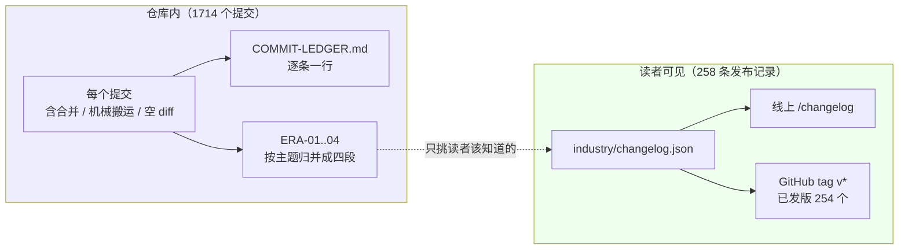

# 仓库历史（docs/history）

这个目录回答三个问题：**这个仓库到底发生过什么**、**读者看到过什么**、**哪些东西可以清理**。

目录里的文件全部是 2026-11-21 一次「仓库史与清理」综述的产物：只读生成，不改业务代码，不改提交历史，不写入任何密钥值。凡涉及凭据的文件只记录键名、长度与副本数量。

---

## 一、先说清两层账：提交台账 ≠ 更新日志

这是读这个目录时最容易混淆的地方，所以放在最前面。

| | 提交台账 | 更新日志（changelog） |
| --- | --- | --- |
| 文件 | `COMMIT-LEDGER.md`（本目录） | [`industry/changelog.json`](../../industry/changelog.json) |
| 单位 | 一个 git 提交 | 一次读者可见的发布 |
| 条数 | **1714**（= `git rev-list --count HEAD`） | **258**（`releases` 数组长度，其中 7 条 `major: true`；`git tag --list 'v*'` 是 254 个，差 4 条，因为 tag 在发布当天才按版本号补，最新几条尚未发版） |
| 作者 | 提交者本人，原样保留 `%an` | 由站长在发布时撰写 |
| 读者能否看到 | 不能，只在仓库里 | 能，线上 `/changelog` 页面直接读 |
| 覆盖范围 | 每一个提交，含合并、`sync:` 机械搬运、空 diff | 只有站长认为读者该知道的变化 |
| 由什么保证 | `git log --reverse` 一次生成，条数逐条核对 | `tests/changelog.test.ts` 钉住形状（新在前、标题 ≤22 字、正文 ≤3 行、每行 ≤80 字） |



一句话：**台账是「发生过的一切」，changelog 是「你该知道的那些」。** 所以 1714 : 258 不是漏记，也不是重复计数，两者根本不在同一层。反过来，台账齐全也不代表 changelog 齐全——差多少、该补哪几条，由 [`AUDIT-CHANGELOG.md`](AUDIT-CHANGELOG.md) 逐条判定。

---

## 二、提交台账

| 文件 | 条数 | 覆盖对象 | 位置 |
| --- | --- | --- | --- |
| [`COMMIT-LEDGER.md`](COMMIT-LEDGER.md) | 1714 | 本仓库 `main` 的 HEAD 全部提交 | 本目录（1729 行：头部说明 + 分隔线 + 1714 行条目） |
| [`COMMIT-LEDGER-SIDE.md`](COMMIT-LEDGER-SIDE.md) | 35 | 本仓库侧分支/远端 ref 上、不在 `main` 历史上的提交 | 本目录 |

`COMMIT-LEDGER.md` 的口径（照该文件头部）：

- 生成命令 `git -c i18n.logOutputEncoding=utf-8 log --reverse --date=short --format='- \`%H\` · %cd · %an · %s'`
- 覆盖 `git rev-list --count HEAD` 报告的 1714 个提交，其中 **358 个合并提交**
- 日期用 `%cd`（提交者日期），标题用 `%s` 原样保留，未改写、未截断
- 按提交时间正序，第一行是根提交 `6220fe11ef5fe75f925e194e645480b050c5d782`（2026-10-01）

> **`COMMIT-LEDGER-SIDE.md` 的口径。** 它覆盖 GEOHOT 自己的 `git log --all --not HEAD`：本次实测 35 个提交（含 1 个合并提交），带 ref 装饰，因此能看到这些提交当时挂在哪条分支/远端 ref 上。它不并入 ERA-01…04 的正文，因为里面多数是并行实验分支与机械同步；HEAD 台账与侧分支台账合计 1749 个提交，等于 `git rev-list --all --count`。另一个仓库（`D:\个人展示网站`）的提交不属于本仓库，不在本文件里。

---

## 三、时代史 ERA-01 … ERA-04

四份文件把 1714 个提交按主题切成四段，每段都锚在具体哈希上，不逐条复述台账。

| 文件 | 时间段 | 区间（`A..B`，起点不含） | 区间提交数 | 这一段的形状 |
| --- | --- | --- | --- | --- |
| [`ERA-01.md`](ERA-01.md) | 2026-10-01 → 10-11 | `6220fe11..d1b9956e` | 400 | 上线当天到档案回填；10-02 的 177 个提交里 165 个是机械搬运，真正的判断不在里面 |
| [`ERA-02.md`](ERA-02.md) | 2026-10-11 → 10-23 | `d519cf82..ae778c90` | 455 | 从「出得了刊」到「出得来、看得见、查得清」；信源 305 → 668 |
| [`ERA-03.md`](ERA-03.md) | 2026-10-23 → 11-05 | `350655a3..293b7571` | 428 | 从「功能上线」转向「同一台 891MB 的机器上读者优先」；更新日志 56 → 127 条 |
| [`ERA-04.md`](ERA-04.md) | 2026-11-05 → 11-21 | `e52d49b6..2e5edf22` | 428 | 五节点干线 + 读者不等冷算；以「修」为主（`fix` 152 条） |

**四段合计怎么对上台账的 1714**（本次实测，`git rev-list` 逐段计数）：

- 四段各自计数相加 = 400 + 455 + 428 + 428 = **1711**
- 去重后只覆盖 **1710** 个提交——`ae778c90`（ERA-02 的终点）同时落在 ERA-03 的区间里，被数了两次
- 四段之外还有 **4** 个提交：根提交 `6220fe11`（ERA-01 的起点被排除）与三个接缝 `d519cf82`、`350655a3`、`e52d49b6`
- 1710 + 4 = **1714**，与 `git rev-list --count HEAD` 一致

四段之间没有整块遗漏，只有上述 4 个单提交空档。

---

## 四、审计

2026-11-21 做了六份审计：四份是核心面（日志 / 可部署性 / 结构 / 同步），两份是补录（工作区 / 安全）。

| 文件 | 管什么 | 一句话结论 | 位置 |
| --- | --- | --- | --- |
| [`AUDIT-CHANGELOG.md`](AUDIT-CHANGELOG.md) | 更新日志的覆盖与完整性 | 7 个 major 全部有专题卡且标题逐字一致；日志之后 6 个非合并提交里 1 个必须补、1 个建议补、1 个属边界、3 个不该硬造；另有 254 条里 103 条缺 `kind`（审计当时的口径，本文件未改审计原文），`/changelog` 上类型标签为空 | 本目录 |
| [`AUDIT-DEPLOYABILITY.md`](AUDIT-DEPLOYABILITY.md) | 陌生人克隆后能否跑起来、能否换域名换机器 | 文档层 / 脚本层 / 模板层的关键事实互相对得上（逐条对着代码读过），但「克隆 → `npm ci` → 起库 → 迁移 → 冒烟」这条链**本轮一行都没执行**，所以给的是代码级证据与「照抄会卡在哪」 | 本目录 |
| [`AUDIT-STRUCTURE.md`](AUDIT-STRUCTURE.md) | 结构与冗余 | 模块层几乎没有死文件（`apps/` 169 + `packages/` 205 个非测试 `.ts/.tsx/.mjs`，`refs:0` 只有一个 3 文件小簇）；冗余集中在运维与材料层：7 组逐字节相同的文件、9 个全仓无人命名的条目 | 本目录 |
| [`AUDIT-SYNC.md`](AUDIT-SYNC.md) | 本地 / GitHub / 生产三端是否同一个 SHA | 本地、GitHub `origin/main`、生产 health 的 `.release` 三者一致在 `2e5edf22`；杭州协调+执行节点停在 `284c766`，落后 13 个提交；读者节点与 WH 节点本次未读到 | 本目录 |
| [`AUDIT-WORKSPACE.md`](AUDIT-WORKSPACE.md) | `D:\地理热点网站` 顶层（不含 `GEOHOT/`）的体积、类型与用途 | 工作区 672,387,256 B ≈ 641.2 MiB / 25,649 个文件；本轮 **0 删除 / 0 移动** | 本目录与工作区 `docs/history/` 各存一份，`md5sum` 相同（`5f21faac…`） |
| `AUDIT-SECURITY.md` | 仓库与工作区的敏感信息与泄露面 | 代码仓库这一侧干净（1290 个跟踪文件里只有两个 `.example` 模板；1749 次提交全量扫描 8 类密钥样式 0 命中）；风险全部落在仓库之外的工作区明文堆，21 组 | 只在工作区 `docs/history/`，**刻意不放本仓库**：`GEOHOT` 是公开仓库，把凭据文件的位置写进 `docs/` 等于向公网公布它 |

**为什么安全审计在仓库外。** `AUDIT-SECURITY.md` 与 `security-findings.json` 刻意只放在 `D:\地理热点网站\docs\history\`：这是公开仓库，把本机凭据文件的位置写进 `docs/` 等于向公网公布它们。仓库内只保留这份索引与不含位置细节的结论；克隆者看不到具体凭据路径，这是有意设计。

---

## 五、清理

| 文件 | 内容 | 状态 |
| --- | --- | --- |
| [`cleanup-candidates.json`](cleanup-candidates.json) | 18 条结构审计候选，字段 `path / action / reason / evidence / risk / references` | 已有 |
| [`CLEANUP-PLAN-20261121.md`](CLEANUP-PLAN-20261121.md)、[`cleanup-plan.json`](cleanup-plan.json) | 41 条逐条拍板的执行计划（含安全/工作区项） | 已生成 |
| [`CLEANUP-EXECUTED.md`](CLEANUP-EXECUTED.md) | 实际执行/跳过的记录 | 已执行 auto 项；manual/keep 保留 |

计划分布（从 `cleanup-plan.json` 统计）：`delete` 13 条、`archive` 10 条、`keep` 18 条；其中 `requiresManual=true` 22 条。**只执行了两轮复核通过的 auto 项**；manual/keep 没有删除或移动。高风险明文凭据副本已移入 `D:\GEOHOT-SECURE-VAULT\20261121` 并收紧 ACL，轮换/撤销仍需站长在服务商侧完成。

读这张清单要注意两件事：

- `cleanup-candidates.json` 的 `path` 是**相对工作区根** `D:\地理热点网站` 写的，仓库内文件带 `GEOHOT/` 前缀；`cleanup-plan.json` 已归一化为 `scope=repo|workspace`，执行脚本按 scope 解析，不再混用前缀。
- `keep` 的 3 条也是结论的一部分：`assets/leaderboard-sources/`、`assets/model-providers/` 属于已关停模块，但 `NOTICE:35-41` 大意是「保留以便上游模块被重新启用」，不是遗漏。
- 自动项已经执行：仓库内跟踪文件删除可从 git 历史取回；工作区删除项先移入 quarantine，跑过 typecheck/构建/测试后随最终清理删除；manual/keep 原样保留。

---

## 六、机读件

| 文件 | 由谁产出 | 形状 |
| --- | --- | --- |
| [`cleanup-candidates.json`](cleanup-candidates.json) | `AUDIT-STRUCTURE.md` | 数组，18 项 |
| [`cleanup-plan.json`](cleanup-plan.json) | `CLEANUP-PLAN-20261121.md` | 数组，41 项；字段 `path, scope, action, reason, evidence, risk, requiresManual` |
| [`workspace-inventory.json`](workspace-inventory.json) | `AUDIT-WORKSPACE.md` | 数组，字段 `path, size, kind, evidence, recommendation`（取值 keep / archive / delete / review） |
| `security-findings.json` | `AUDIT-SECURITY.md` | 数组，字段 `where, kind, evidence, tracked`；**不含任何秘密值**，只到键名与长度 |

`security-findings.json` 与 `AUDIT-SECURITY.md` 同样只在工作区 `docs/history/`。

---

## 七、复现

以下命令在 `GEOHOT/` 下执行，输出应与上文数字一致：

```bash
git rev-list --count HEAD                      # 1714
git rev-list --merges --count HEAD             # 358
grep -c '^- `' docs/history/COMMIT-LEDGER.md   # 1714
git tag --list 'v*' | wc -l                    # 254
node --test tests/changelog.test.ts            # 2 pass，钉住 changelog 形状
node -e "const c=require('./industry/changelog.json');console.log(c.releases.length)"   # 258
```

四段区间的计数：

```bash
git rev-list --count 6220fe11..d1b9956e   # 400
git rev-list --count d519cf82..ae778c90   # 455
git rev-list --count 350655a3..293b7571   # 428
git rev-list --count e52d49b6..2e5edf22   # 428
```

---

## 八、口径与已知偏差

- **`git log --since/--until` 只写日期时不可复现到天。** ERA-02/03/04 都踩过：这台机的时区与提交自带的 `+0800` 不一致，边界提交会在两次运行之间跳进跳出。要可复现就用显式时区（`--since='2026-11-05 00:00:00 +0800'`）或哈希区间。四段时代史一律以哈希区间为准。
- **同一个窗口可以有多个都对的提交数。** 哈希区间、台账按 `%cd` 的日历切片、`--since/--until` 三条口径在带侧支的 DAG 上必然不同。各文件都写明了用的是哪条，不要跨文件直接相减。
- **`AUDIT-WORKSPACE.md` 的 `.mimosa/` 数字有两个版本**：初稿 10:14 测得 13,111 文件 / 102.9 MB，11:05 复测 24,045 文件 / 188.8 MB——原因是审计进行期间 `hook-state` 仍在写入。正文已按复测值改写，初稿数字只在对照处保留。
- **未验证的部分**：`AUDIT-DEPLOYABILITY.md` 没有跑构建与迁移；`AUDIT-SYNC.md` 没读到读者节点与 WH 节点的 `.release`；`AUDIT-SECURITY.md` 没有确认服务器端凭据是否已轮换。这三处都写在各自文件的「未验证」里，本索引不替它们升级结论。
- **本目录不含密钥。** `security-findings.json` 与 `AUDIT-SECURITY.md` 只记键名、长度、副本分组编号（K1/K2…），编号本身不可还原。

---

相关：[`docs/PROJECT-MAP.md`](../PROJECT-MAP.md)（目录职责与运行 / 迁移 / 发布 / 运维 / 归档的分层）· [`docs/architecture.md`](../architecture.md)（系统架构）· [`docs/known-issues.md`](../known-issues.md)（问题台账）
